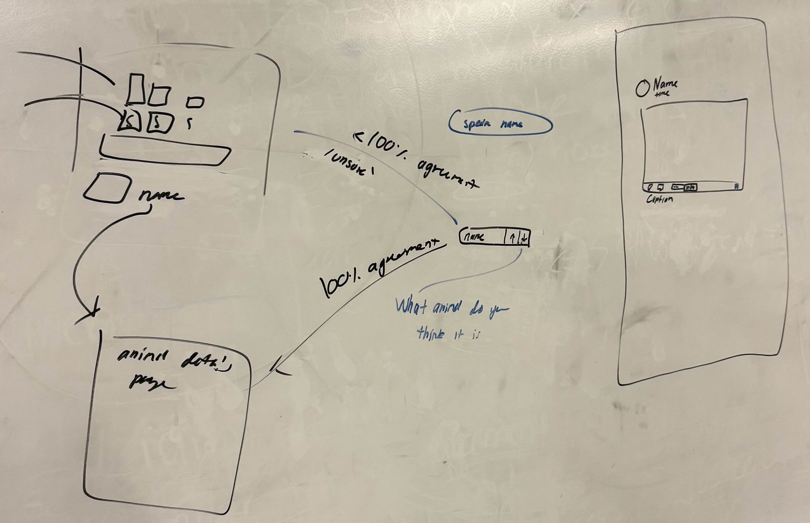
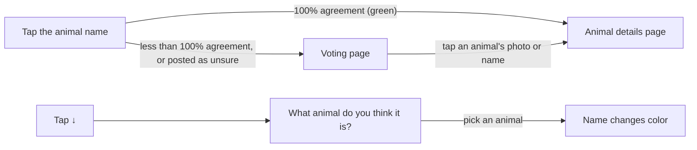

# Animal identification voting

How the community agrees on what animal a post shows. Agreed in the team meeting of 2026-11-18;
the sources are the whiteboard photo (`whiteboard.jpg`) and the meeting's speech-to-text
transcript (`transcript.txt`). Tracked by #150 (Confidence level measuring).

## Post card

The sketch on the right of the whiteboard: the poster's avatar, username and time, then the photo,
with an action bar along its bottom edge holding, left to right:

1. like
2. comment
3. the animal name control: `[ name | ↑ | ↓ ]`
4. bookmark, at the far right (#148, Favorite Posts)

The caption goes under the photo.

## Animal name control

- Shows the animal the post is currently identified as.
- **↑** agrees with that animal.
- **↓** disagrees, and opens a popup asking "What animal do you think it is?". It lists the
  animals iNaturalist suggests for the photo, and the voter picks one.
- The name is **green** while everyone agrees. Once anyone picks a different animal it changes
  color (yellow was the example).

## Tapping the name

- With no disagreement, the name opens that animal's details page, so a user who doesn't know the
  animal can compare the photo with what the animal looks like.
- With any disagreement, or when the poster marked the animal as unsure (#56), the name opens the
  voting page instead.

## Voting page

The sketch at the top left of the whiteboard:

- A bar for each animal people voted for, showing how many chose it, each with a photo of the
  animal.
- The poster's choice is always first, marked with the poster's initials.
- Each animal's photo and name open its details page. Voting is a separate control, so a tap
  never does both.

## When most voters disagree with the poster

If enough votes go to another animal, the post switches to it. In the example, the poster tagged
a raccoon and 99 of 100 voters picked possum, so the post shows possum, with high confidence. The
meeting left the threshold open; see below.

## Decisions made while building it

The meeting left these open; #150 settled them as follows. Revisit any of them as a team.

- **Switching:** a post shows another animal once that animal has more than half of all votes,
  the poster's included (`SWITCHING_SHARE`). At exactly half the poster's animal stays.
- **Colors:** green at 100% agreement, yellow below it; no gradient.
- **Choosing an animal:** the popup searches the app's animal list (`AnimalRepository`), so a
  voter can't type a name that isn't in it.
- **↑:** votes for the animal the post shows. Tapping a highlighted arrow again withdraws the vote.
- **Poster:** the poster's animal is their vote, so they get only ↓, which reclassifies the post:
  it names the new animal, clears every vote and removes the 1–5 confidence rating.
- **Wide bar:** the voting page's rows each have a bar showing that animal's share of the votes.
- **Animal photos:** the voting page has none until iNaturalist (#125) supplies them.
- **Unsure posts (#56):** "I don't know what it is" on the post screen leaves the animal blank, with
  no confidence, so it needs no new field, and posts that never named an animal count as unsure
  too. Until an animal has more than half of the votes, the name control reads "What animal is
  this?" in yellow and opens the voting page, which asks the same and has a button to suggest an
  animal. With nothing to agree with there's no ↑; others' ↓ suggests an animal, which votes for
  it, and the poster's ↓ names it, as reclassifying does.

## Dependencies

- **iNaturalist suggestions (#125, kaylamcneill47).** iNaturalist's photo identification
  (`/v1/computervision/score_image`) no longer accepts personal API tokens. It takes an OAuth
  application token, and registering an OAuth application requires an iNaturalist account at
  least two months old with ten or more improving identifications in the past month. If that
  isn't possible, the popup can list iNaturalist species search results, or species often
  observed near the post's location, instead.
- **Animal details page (#154, unassigned).** Until it's built, the name can open the existing
  page of posts that name the animal (`AnimalPostsScreen`).
- **Unsure posts (#56)** build on the same voting page; see the decisions above.
- **Correct misidentifications (#61, unassigned)** covers the same ground as this design.

## Where it lands in the code

- The name control (`ui/voting/AnimalVoteControl.kt`) sits in each post's like and comments row,
  and the 1–5 confidence rating stays under the caption.
- A user's vote is `users/{uid}/votes/{postId}`, holding the animal and the post's voting round.
  The post's `voteCounts` change in the same batch, and the rules check they change by exactly that
  vote. Reclassifying starts the next round (`voteRound`), so earlier votes stop counting without
  the poster deleting other users' documents.
- The shown animal and agreement are worked out in `data/AnimalVotes.kt` and kept as `PostTable`
  columns, and `ui/voting/Identification.kt` turns them into the name control's state: unknown,
  agreed or disputed. The voting page (`ui/voting/VotingScreen.kt`) reads one post's tally when it
  opens.
